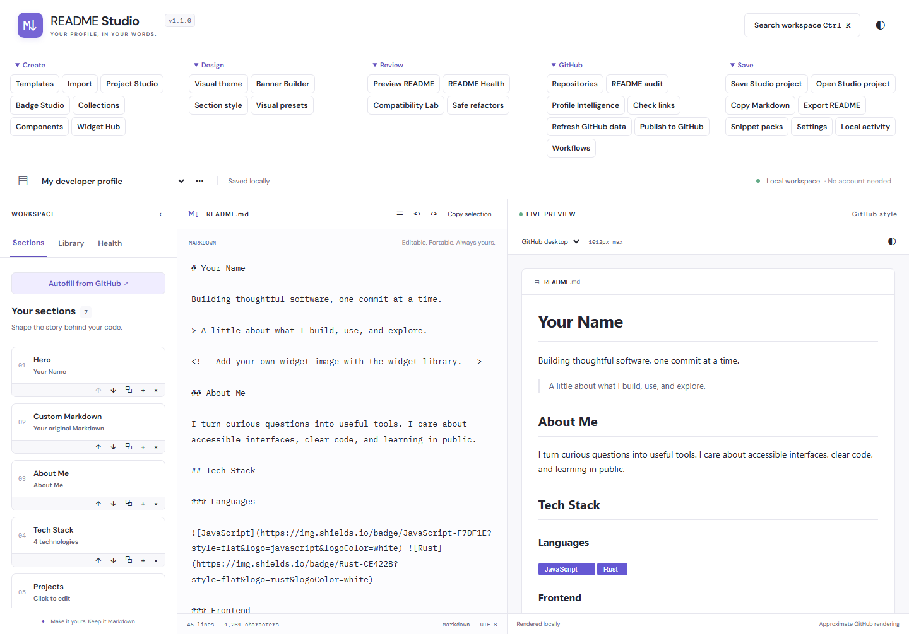

# README Studio

A local-first workspace for creating GitHub profile and repository READMEs. Build visually, edit Markdown directly, and export an ordinary `README.md` with no Studio runtime dependency.

**Version 1.9.28.** Multilingual documentation maps separate language editions to explicit workspace documents and target paths, reviews exact source-revision drift conservatively, and marks English-specific guidance Unknown for non-English editions. No translation, source edit, or remote write is automatic. [Multilingual documentation](docs/multilingual.md) · [Privacy](docs/privacy.md)



## The problem it solves

A good README is one of the most valuable things a project can have, yet most people either skip it, write it once and let it rot, or copy a template that doesn't fit. Profile READMEs, repository READMEs and multilingual editions all need different structure, and it is hard to tell what a README is missing or whether it has drifted from the code.

README Studio makes this easier. It helps you build, review, audit and maintain READMEs locally, in your browser, and exports an ordinary `README.md` that has no dependency on Studio. Your drafts stay on your machine unless you explicitly choose to fetch public GitHub data or publish.

## Install and run

Requires Node.js 22.12 or newer.

```sh
git clone https://github.com/zero-to-mastery/ZTM-Build-Fest.git
cd ZTM-Build-Fest/projects/github-readme-generator
npm ci
npm run dev
```

Open the local URL that Vite prints (usually `http://localhost:5173`). To produce a production build, run `npm run build` and serve `dist/` with any static HTTP server. See [Build and verify](#build-and-verify) for tests.

## How AI is used

- **In the product (optional):** The [Writing assistant](docs/writing-assistant.md) can draft or improve selected README text through a chat-completions endpoint that you configure. It is off by default, needs your own endpoint and key (held in memory only), shows exactly what will be sent, and never changes your draft until you approve an Original → Proposed → Diff → Apply review. Everything else works with no AI account. See [AI safety](docs/ai-safety.md).
- **Everything else is deterministic:** Analysis, audits, compatibility checks and dependency detection use explicit rules, not AI.
- **In development:** AI was used extensively to build this project. I used spec-driven development: AI helped plan the work as written specs (see [roadmap.md](roadmap.md)), implement each spec, and write and run the tests that verify it. The code, docs and tests were produced with AI assistance, and the automated test suite (see [Build and verify](#build-and-verify)) is the check on the result.

## Start locally

```sh
npm ci
npm run dev
```

Guided start asks whether you want to write a profile README, write a repository README or audit your repository READMEs, and says where your work is kept; templates, Markdown import, Studio projects and blank drafts remain one click away. After you start, [Next steps](docs/next-steps.md) suggests what usually comes next without changing anything. Use the Create, Design, Review, GitHub and Save groups; `Ctrl/Cmd+K` searches tools and content. [Getting started](docs/getting-started.md) · [Task tutorials](docs/tutorials.md) · [Usability scripts](docs/usability-scripts.md) · [All documentation](docs/index.md)

## What you can do

- Compose sections, badges and collections, project showcases, components and reusable snippets.
- Coordinate themes, generate local light/dark SVG banners, and configure attributed external widget embeds.
- Import public GitHub data, review refreshes, analyze compatibility and apply explicit, undoable refactors.
- Review a README for end users, recruiters, contributors or maintainers, distinguish unknown evidence from topics not detected, and optionally apply a reviewed section order without rewriting section text.
- Practice README writing through optional Profile, CLI, Library, API, or Game lessons, annotated synthetic examples, and portable advisory checklists without automatic source edits.
- Manage localized README editions with explicit paths, manually review source-section drift, and keep language-dependent analysis uncertainty visible.
- Audit selected public repositories with advisory expectations for 14 project types, review an evidence-backed [Improvement plan](docs/repository-auditing.md#improvement-plans) for each, optionally compare explicit [Audit snapshots](docs/repository-auditing.md#audit-snapshot-history-1910), then choose the next README from the attention queue.
- Analyze declared dependencies in repository manifests with explicit consent, including bounded monorepo discovery that maps Workspace members and Nested projects ([Stack Intelligence](docs/stack-intelligence.md)). Every declaration shows where and when it was observed and a named confidence basis, with uncertain and Stale results labelled ([Provenance, confidence and staleness](docs/stack-intelligence.md#provenance-confidence-and-staleness)).
- Record read-only evidence snapshots of a repository's branch head, README, manifests and linked files, then check what changed since a pinned Baseline.
- Check for stale scripts, missing files, broken links and anchors, and outdated config keys without running repository code or changing your Markdown.
- Save portable `.readme-studio.json` projects or export Markdown, packs and full workspace backups.
- Optionally publish reviewed README, asset and workflow changes through a separately configured GitHub App service. Publishing starts read-only and unlocks only after a [Preflight](docs/github-publishing.md#preflight) of app, permission and branch access passes. A [change set review](docs/github-publishing.md#change-set-review) lists every file write with its Base and Result SHA, and publishing needs an explicit approval of that exact set.

Manual Markdown remains available. Raw edits change only the sections they touch: untouched builder sections keep their visual ownership, and any section that is detached is named in a status message and in the Sections list. Themes guide generated content; they cannot style GitHub itself. The app light/dark switch updates preview too, with a separate preview override.

## Your data

Drafts autosave to this browser. **Download a backup before clearing browser storage**; **Restore a backup** in Guided start brings it back and opens your restored draft. Export README, Copy Markdown, Save Studio project and the backup downloads ask before leaving out section edits you have not saved. Storage failures remain visible, and damaged data opens a temporary workspace with recovery downloads rather than silently replacing originals. Portable projects retain source and supported editing metadata; Markdown exports retain source only. [Editing and recovery](docs/editing.md) · [Project files](docs/studio-projects.md)

Core editing, analysis and export work offline after the production app has successfully cached. Public GitHub fetches, publishing and remote images need a connection. Remote previews contact their providers directly. [Offline behavior](docs/offline.md) · [Privacy](docs/privacy.md) · [Security](docs/security.md)

## Build and verify

```sh
npm test
npx playwright install chromium firefox webkit
npm run test:browser:all
npm run build
npm run test:static
npm run report:bundle
```

Serve `dist/` with a static HTTP server, GitHub Pages subpath or Netlify; no router fallback or frontend environment variables are required. Opening `index.html` through `file://` is not supported. Optional publishing needs the [HTTPS server setup](docs/github-publishing.md); a static deployment alone does not enable writes.

[Contributor guide](CONTRIBUTING.md) · [Architecture](docs/architecture.md) · [Synthetic examples](examples/README.md) · [Known limitations](docs/known-limitations.md) · [Changelog](CHANGELOG.md)

MIT licensed. See [LICENSE](LICENSE) and [third-party notices](THIRD_PARTY_NOTICES.md). Preview approximates GitHub; automated browser tests are not accessibility certification or proof of a live publishing deployment.
