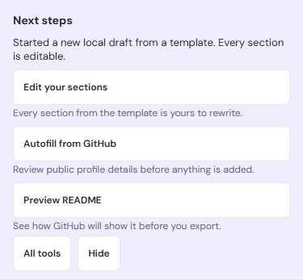

# Next steps

After you import a README, open one from the README audit, pick a template or start blank, a **Next steps** panel appears above the workspace panes. It suggests at most three existing tools that usually come next, each with a one-line reason, and says what just happened, for example "Imported into a new local draft. Nothing changed on GitHub."

A Next step only opens a tool, the same as its button under **Workspace tools**. It never edits your Markdown, applies a change, contacts GitHub or publishes. Any change still goes through that tool's own review, stale-draft check and Undo. **All tools** opens workspace search (`Ctrl/Cmd+K`), so every other tool stays one step away.

## What is suggested

The suggestions depend on how the document arrived and on a few cheap facts: how many sections it has, whether it has a repository target, your [Guided start](guided-start.md) goal, and whether the browser is online. Nothing is analysed or fetched to choose them, and the order is fixed.

| Arrival                                                    | Next steps                                                                                    |
| ---------------------------------------------------------- | --------------------------------------------------------------------------------------------- |
| Profile template                                           | Edit your sections · Autofill from GitHub · Preview README                                    |
| Repository README template (repository README builder)     | Replace writing prompts · README Health · Set repository target (Preview README once set)     |
| Import as a new draft or replacement, one Markdown block   | Split into sections · README Health · Drift check when there is a target, else Preview README |
| Import as a new draft or replacement, structured or empty  | Preview README · README Health · Drift check when there is a target, else Compatibility Lab   |
| Import appended or merged (including Re-import)            | Preview README · README Health · Compatibility Lab                                            |
| Opened from the README audit (new or existing document)    | README Health · Drift check (only with a target) · README Attention Queue                     |
| Blank document from Guided start                           | Add a section · Start from a template · Import existing README                                |
| Studio project opened as a new draft (counts as an import) | As for an import as a new draft                                                               |

Opening the existing README unchanged from the repository README builder counts as a GitHub import; doing it from the README audit counts as an audit. A template with no clear kind follows the document's group, then your goal.

The steps are worked out again when a tool's dialog closes and after **Undo** or **Redo**, so after **Split into sections** or **Set repository target** the panel shows what fits the document now. A step that is still offered keeps its button, so focus stays on it; when a step is replaced (for example **Set repository target** by **Preview README** once a target is saved), focus moves to the step now in its place.

### Offline and temporary workspaces

While the browser reports it is offline, steps that read GitHub (Autofill from GitHub, Drift check, README audit and the Attention Queue) are left out and the panel says "GitHub steps are hidden while offline." They return when the connection does. When browser storage is unavailable, or saving fails later (for example because storage is full), the last step becomes **Export README**, so work in a temporary workspace is not lost.

## Keyboard and focus

- The panel never takes focus when it appears, and it is not a live region; the usual notification announces what happened, for example "Import complete.", "Minimal template opened as a new local draft." or "Blank draft created."
- It sits after the draft controls and before the panes, so `Tab` from **Current draft** passes **Documents** and **Manage drafts**, then reaches the steps, **All tools** and **Hide**.
- A step that opens a dialog returns focus to that step when the dialog closes without applying anything. A tool that applies a change moves focus as it always does (for example to the editor after a split).
- While any dialog is open the panel cannot be reached, like the rest of the page.
- **Hide** removes the panel for this document and moves focus to the Markdown editor, or to **Current draft** when the editor is not visible (for example on the mobile Build pane).

## How long it stays

The panel belongs to the document that just arrived. It stays until you choose **Hide**, switch to another document, restore a workspace backup, start another Arrival or reload the page. Undoing an import that replaced, appended to or merged into the document also removes it, because it no longer describes the document. Nothing about it is saved: there is no per-document guidance in storage, backups or Studio projects (ADR 0005).

## Turning it off

**Save → Settings → Guidance → Show next steps after imports, audits and templates** turns the panel off or on. The choice is part of the workspace's `guide` field (ADR 0004), saved in this browser and in all-drafts backups, never in Studio projects, single-draft JSON or README exports. With it off, the panel never appears; every tool is still in **Workspace tools** and workspace search.
