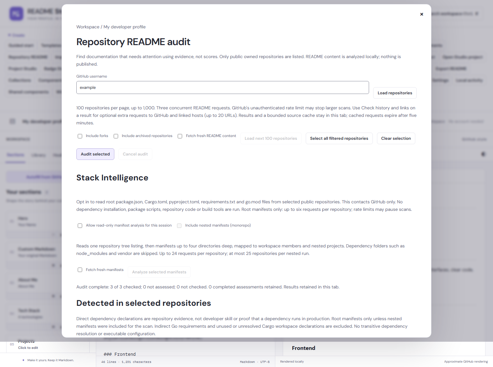
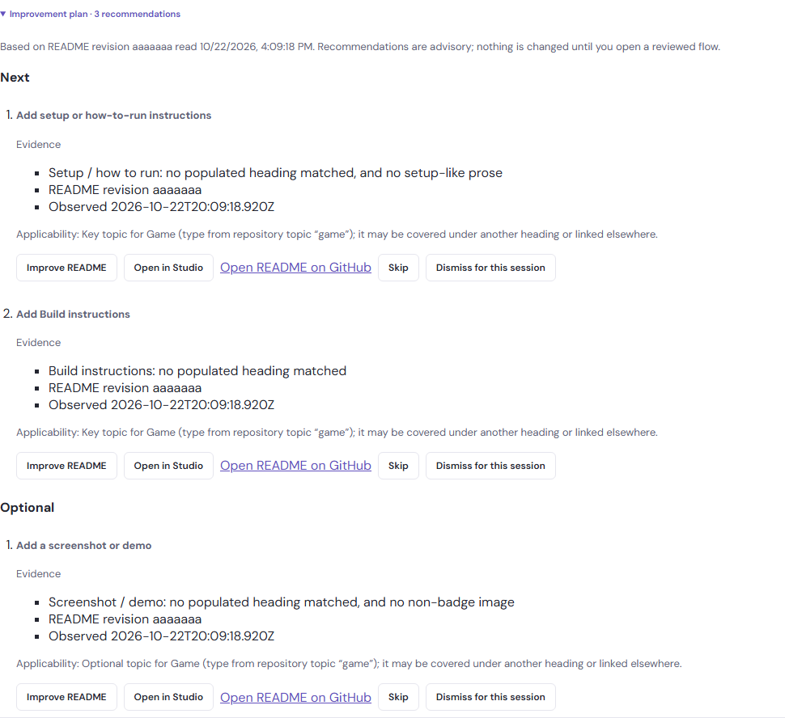

# Repository README auditing

Open **GitHub → README audit**, or search for it with Ctrl/Cmd+K. Enter a GitHub username/profile URL and load public owned repositories. Forks and archived repositories are excluded initially; each can be included explicitly.

Select repositories individually or select all currently filtered repositories, then choose **Audit selected**. Listing repositories does not fetch their READMEs. Results show the README state, primary language, push/update timestamps, archive/activity status and the evidence behind the classification. Results stay in repository-name order; there is no score, percentage, developer ranking or automatic rewrite.

**Open README** and **Open repository** link to GitHub. **Improve README** opens the repository README builder with a suggested template and editable repository context. Existing source is preserved by default; a missing README can start from the selected template. Choose Open existing README unchanged to retain the earlier exact-source/blank-draft workflow. Your current draft remains available and nothing is published. Use normal editing, Health, refactors and export afterwards.

## Improvement plans

Every audited row, and every README Attention Queue entry, has an **Improvement plan** disclosure. Open it with a click or Enter/Space on its summary, **Improvement plan · N recommendations**. A plan is calculated from the audit results already in this tab: it makes no request, reads no README source again and works offline. It is not a score, and nothing changes until you open a reviewed flow.

The plan begins with **Based on README revision abc1234 read …**, the README revision and time the evidence came from. Each Recommendation comes from exactly one Audit finding and shows:

- **A title** that names what to add or review, for example **Add an Installation section**, **Replace Vite starter text** or **Review unavailable link**. Studio never writes the section, a command, a URL or a fact for you.
- **Evidence** quoting only what the audit observed: the classification metrics, the topic and "no populated heading matched", the URL and "HTTP 404/410 at check time", the README history dates and commit count, and always the README revision and a time. README evidence shows **Observed** with the time the audit read the README; link, image and history evidence shows **Checked** with the time **Check history and links** finished.
- **Applicability**: the project type and where it came from (chosen by you, a repository topic, README prose, a name hint or the generic fallback), plus caveats. Every topic may be covered under another heading or linked elsewhere. Authentication does not apply to APIs without authentication. A license may already be covered by a LICENSE file, which the audit does not read. When the README has a link whose text or address names documentation (docs, documentation, reference, manual, guide or wiki, or API in the link text), an API reference may be a deliberate alternative. Other links, such as a LICENSE file or a homepage, do not count.

Recommendations are grouped into three **Plan bands**. Bands order the work; they are not ratings.

| Band       | Recommendations                                                                                                                                |
| ---------- | ---------------------------------------------------------------------------------------------------------------------------------------------- |
| Start here | Missing README, stub or minimal README, starter text (Create React App, Vite, Next.js), placeholders (TODO, your-project-name)                 |
| Next       | Key project-type topics that were not detected (the same subset the queue uses), unavailable links and images from **Check history and links** |
| Optional   | Other profile topics, README history that predates significant activity, and topics downgraded by a caveat below                               |

When the README is missing or a stub, a single Start-here Recommendation lists the type's undetected key topics as sections to consider when writing it, instead of one Recommendation per topic. Within a band the order is fixed: README, starter, placeholder, topic, link, image, history, then the type's topic order, then the finding ID. A plan lists at most 30 Recommendations and says how many more were not shown.

Topic Recommendations move to Optional, with a caveat at the top of the plan, when:

- the project type is a weak inference (a name hint or the generic fallback) and you have not chosen one: "Project type is a weak inference; choose a type if this is wrong";
- the README has at least 80 prose words and two headings, yet no heading used any English topic term (Overview, Examples and Links count) and no setup or usage was recognised: "Headings may not be in English; topic detection uses English terms".

An Experiment's findings topic and an API reference next to documentation links are always Optional. Repository activity, stars and archive state never change a plan.

### Plan actions and decisions

Each Recommendation offers **Improve README** (the repository README builder, which already preselects missing sections), **Open in Studio**, **Open README on GitHub**, **Skip** and **Dismiss for this README revision**. A missing or thin README cannot be dismissed; it offers **Mark intentionally minimal**, the queue's existing decision, instead.

- **Skip** sets a Recommendation aside for this session. It moves into **Skipped (n)** with **Restore** and never changes the queue.
- **Dismiss for this README revision** states the Recommendation does not apply to the observed README revision and persists that decision on this device. It moves into **Dismissed for this README revision (n)** with **Restore**, and its gap or finding also leaves the queue's reasons and eligibility. A changed README revision makes the dismissal stale. Dismiss needs a known README revision; without one it is disabled with "Refresh the audit to obtain a README revision".
- A dismissal made for an earlier README revision is not applied after a fresh audit sees a different revision. The Recommendation returns with "Dismissed for an earlier README revision", **Dismiss again** and **Forget earlier dismissal**. When a fresh audit has no README revision at all, the dismissal is not applied either. The Recommendation says the audit has no README revision to compare and offers **Forget earlier dismissal**; it does not claim the README changed.

After Skip or Dismiss, focus moves to the next Recommendation's first button, or to the plan summary when none is left. Status messages use the audit or queue status region. Skip lasts for this tab session. Dismiss persists locally for the observed README revision and becomes stale after a changed revision is fetched. Improve README and Open in Studio keep their existing fetch and error behavior.

Empty states are explicit. A repository that could not be read shows **Not assessed - audit this repository to build a plan**; a failed fetch never produces a missing-README plan. A plan with nothing to suggest says "No recommendations from the current evidence. This is not a quality verdict." When everything is skipped or dismissed, the counts and Restore buttons remain.

`tests/improvement-plan.test.js` covers every finding kind and band, order and the 30 cap, evidence and applicability, failed records, empty and folded plans, session decisions, queue reasons and stable finding IDs, plus type-specific false positives (CLI usage, external API docs, public APIs, experiments, documentation and game repositories, weak and non-English types, fenced TODOs, badge-only and archived repositories). Browser coverage in `attention-queue.spec.js` and `repository-audit.spec.js` opens plans by keyboard at 320px, checks evidence, focus after Skip and Dismiss, queue reasons, offline use and Improve README.

## Audit snapshot history (1.9.10)

**Capture current audit results** is an explicit, offline copy of successful Audit results already in this tab. It does not fetch a README, repeat an audit, poll, schedule work or run in the background. The local snapshot stores canonical repository names, observed README revisions and times, states, project-type IDs, whether the type was Manual, whether history and links were checked, and finding IDs. It keeps URLs only for already-observed unavailable link/image findings. It never stores README source, evidence prose, Improvement-plan text, Skips, Dismissals or attention decisions.

History is deliberately bounded: five captures per account and 20 total, up to 1,000 repositories and 60 findings per repository, at most 20 unavailable URLs per repository, with a two-million-character cap for the whole key. A sixth capture replaces only that account's oldest and says so. The app refuses a total/size overflow rather than evicting another account. Delete is explicit. Damaged data remains untouched and downloadable; capture stays disabled until the author confirms starting fresh with Audit snapshots. These captures stay in `readme-studio:audit-snapshots:v1`, outside drafts, all-drafts backups, Studio projects and README exports.

Choose an Earlier and Later capture, then **Compare snapshots**. Added and Resolved are reported only when a repository was assessed in both captures, the later audit re-read it, Audit/plan rule versions match and the project type (including Manual-vs-Automatic origin) is unchanged. Link/image findings require link checks in both captures; history findings require history checks in both. A missing repository, retained session result, changed rule/type or partial optional check is **Unknown** with its reason. This is a comparison between two explicit observations, not live monitoring and not proof that repository quality improved or regressed.

## Choosing the next README (1.1.2)

Switch to **README Attention Queue** after auditing. It uses these assessments to offer descriptive priorities, combined filters, new-draft actions and revision-bound local dismissals. The [queue guide](readme-attention-queue.md) documents the rules and recovery behavior. Audit results remain in repository-name order; the queue is a separate view.

## Project types (1.1.1)

Each repository shows **Suggested type: CLI** (or another type), a reason, and an explicit uncertainty note. Select **Project type for owner/repository** to override the suggestion before or after scanning. Once a README revision is observed, the Manual project type is saved locally for that canonical repository and continues to apply after reloads, account switches and README changes. Its observed revision is retained for display only. Select **Automatic suggestion** to delete the saved type. Changes reassess cached evidence immediately without requesting source again. They do not change draft metadata or exported Markdown. **Reset saved audit decisions** removes the repository's Manual project type and Dismissals without changing its README source or attention preference.

Suggestions use public repository topics, explicit English README prose and weak name hints. Topic matches take precedence over prose, then names; ties use a stable specificity order: PWA, CLI, API, Game, package ecosystems, Web App, Library, Documentation, Tutorial, Experiment, Open Source Project. Other matching types are shown. No specific signal means Generic Repository. Primary language and homepage alone do not establish a package or application. This release does not fetch package manifests or inspect dependencies, and cannot confirm a package was published. Suggestions may be wrong, especially for monorepos, multilingual documents or prose discussing another project: the manual choice always wins.

| Type                                      | Commonly useful documentation topics                                                       |
| ----------------------------------------- | ------------------------------------------------------------------------------------------ |
| Web App                                   | Overview, screenshot/demo, setup, environment/configuration, testing, deployment           |
| Library                                   | Purpose, installation, usage, API, compatibility, examples, contributing                   |
| CLI                                       | Installation, commands, flags/options, examples, configuration                             |
| API                                       | Setup, authentication, endpoints, environment/configuration, sample requests/responses     |
| npm Package / Rust Crate / Python Package | Purpose, installation, usage, API, compatibility, examples                                 |
| Game                                      | Overview, controls, how to run, screenshots, gameplay, build instructions                  |
| PWA                                       | Overview, screenshot/demo, setup, configuration, offline/installation behavior, deployment |
| Documentation                             | Purpose, navigation, examples, contributing                                                |
| Open Source Project                       | Overview, setup, usage, contributing, license                                              |
| Tutorial                                  | Purpose, prerequisites, learning steps, examples                                           |
| Experiment                                | Purpose, optional findings/limitations; a short README may be entirely appropriate         |
| Generic Repository                        | Overview, setup, usage, project/documentation links                                        |

Evidence says **not detected. Commonly useful for this project type.** It does not claim a section is mandatory or actually absent. For example, API authentication may not apply to a public unauthenticated API. A link to extensive external documentation may be a deliberate alternative to in-README instructions. There are no quality percentages, scores or developer rankings.

## Evidence and rules (version 2)

Analysis reuses the existing Markdown analyzer. A leading BOM is ignored for analysis only; original source and byte counts are preserved. Meaningful words count prose rather than headings, images/badge labels, fenced/inline code, comments or executable HTML. A substantive passage has at least 12 words and six distinct words. Images, badges, code examples, non-anchor/non-mailto links and headings are reported separately. Two further counts feed only Improvement plan caveats: links whose text or address names documentation, and headings that use any English topic term. Activity is independent of documentation classification.

For a specific project type, the label includes context, for example **Minimal for a Web App**. Classification uses these combinations:

- Missing stays missing regardless of type. Fetch failures stay **Not assessed**.
- Stub: fewer than 20 meaningful prose words or no substantive passage; code-only and badge-only READMEs remain stubs.
- Basic: at least 40 prose words, one substantive passage and evidence for at least two topics in the selected profile. An Experiment with a substantive overview is Basic even when shorter, without needing setup or usage.
- Detailed: at least 250 prose words, three substantive passages, three headings and evidence for at least four profile topics (all topics for smaller profiles), plus a code example, supporting image or project/documentation link.
- Documentation-heavy: Detailed plus at least 1,200 prose words, eight headings, six substantive passages, and four code examples, four supporting images or four links.
- Minimal: substantive prose but none of the broader combinations. Length alone cannot establish broad coverage.

A topic is detected from a matching populated heading (six prose words or a nonempty code block). Overview also uses substantive prose; examples use code blocks; screenshot/demo uses non-badge/non-widget images; links use safe project/documentation links. Existing explanatory setup/usage phrase detection is reused. These are approximate signals, not a semantic proof that a demo works, API reference is complete, or instructions are correct. Code/comment text cannot suggest a project type or masquerade as actual headings. A real code block under a matching heading can support that section.

Generic Repository retains the baseline combinations below, while displaying advisory generic topics. Rules are evaluated from documentation-heavy down to basic after the stub check:

| State               | Required combination                                                                                                                                                                         |
| ------------------- | -------------------------------------------------------------------------------------------------------------------------------------------------------------------------------------------- |
| Missing             | README endpoint returns 404, or a checked root directory has no README while GitHub exposes a non-root README                                                                                |
| Stub                | Fewer than 20 meaningful prose words or no substantive prose; includes title-only, code-only and badge-only documents                                                                        |
| Minimal             | Substantive prose exists but none of the broader combinations below apply                                                                                                                    |
| Basic               | At least 80 prose words, two substantive passages, plus setup or usage evidence, or two headings and a project/documentation link or non-badge/widget image                                  |
| Detailed            | At least 250 prose words, three headings and three substantive passages, setup and usage evidence, plus a code example, project/documentation link or non-badge/widget image                 |
| Documentation-heavy | At least 1,200 prose words, eight headings and six substantive passages, setup and usage evidence, plus four code examples, four project/documentation links or four non-badge/widget images |

Long text alone cannot qualify as detailed. Empty Setup/Usage headings are not sufficient: their section needs at least six prose words or a nonempty fenced example. English install/setup/requirements and usage/controls/examples terms provide heuristic evidence, including explanatory prose where recognized. These are transparent documentation-coverage rules, not a measure of correctness, project value or developer ability. Other languages and unconventional READMEs may need manual interpretation. A terse library README that links to external docs may be perfectly appropriate despite a minimal classification.

The README endpoint can prefer a file under `.github/` or `docs/`. When that occurs, Studio checks the root Contents listing and reads a root README if present (preferring README.md). If no root README is found, evidence identifies the alternate path. A truncated root listing is **not assessed**, not assumed missing. Deletion/access changes can also produce a 404; results describe the public snapshot, not permanent repository facts.

## Scale, privacy and failure behavior

Load 100 repository records per page, up to 10 pages/1,000 public repositories. The result view renders 25 rows at a time; selection and auditing can span loaded pages. README requests run with at most three concurrent jobs. Analysis runs in a dedicated local Worker with a JavaScript fallback if Workers are unavailable. No remote image previews are loaded by the audit.

GitHub requests go directly to its public REST API with credentials omitted. No sign-in, token input, proxy, repository write or cloud storage is added. Unauthenticated GitHub limits can stop an audit before all 100 or 1,000 selected READMEs are fetched; Studio does not promise to bypass those limits. Rate limits/access denials stop new work, retain completed results and show a retry time when headers permit. In-flight requests may finish. Retry explicitly after the limit resets.

Timeouts, network failures, permissions, oversized/unsupported text and analysis errors remain **Not assessed**, never Missing README. Other repositories continue after ordinary per-repository failures. Cancel or close the dialog to stop scheduling and abort active work. Partial list results remain available if another page fails.

Repository pages and successful/missing README responses are cached in this tab for five minutes. Completed assessments remain for the tab session: subsequent scans retry only failed or unfinished rows, even after the source cache expires. **Fetch fresh README content** explicitly rechecks completed rows too. This allows progress across rate-limit windows without repeatedly fetching the first successful rows. The source cache is limited to about 20 MB of UTF-16 text and 1,000 entries, with oldest entries evicted. Failed reads are not cached. Select **Fetch fresh README content** to bypass successful cache entries. Improving a README may refetch if its source was evicted or expired. Reloading the app clears the session audit. Individual README audits support up to 1 MB of UTF-8 source; larger files can still be opened on GitHub.

API references: [public user repositories](https://docs.github.com/en/rest/repos/repos#list-repositories-for-a-user), [repository README](https://docs.github.com/en/rest/repos/contents#get-a-repository-readme), [Contents](https://docs.github.com/en/rest/repos/contents#get-repository-content). Documentation checked 2026-09-28. The client constructs fixed GitHub API paths and does not follow arbitrary pagination URLs.

## Verification

`tests/project-types.test.js` covers all type suggestions, ambiguous/fallback evidence, all profiles, short experiments, type-dependent classifications, empty/example headings, source preservation and invalid overrides. Browser coverage includes type selection before scanning, keyboard focus, 320px layout, fresh scan/session retention, automatic reset and account isolation. `tests/repository-audit.test.js` covers deterministic states, meaningful content, archive/fork handling, 1,000-repository pagination, bounded concurrency/cache, missing vs failure, root fallback, partial failures, rate limits, cancellation and malformed responses. `tests/browser/repository-audit.spec.js` covers the 100-repository workflow, session reuse, exact-source new drafts, 320px keyboard controls, cancellation and Worker fallback across Chromium, Firefox and WebKit. Network fixtures are synthetic; tests do not scan a real developer or publish anything.

See [repository audit hardening](audit-hardening.md) for conservative placeholder/history findings, optional link checks, retry policy and large-account limits.

In v1.2.0, Improve README / Improve next opens the [repository README builder](repository-builder.md) with an appropriate template and reviewed metadata. Open in Studio still preserves the exact original source.
